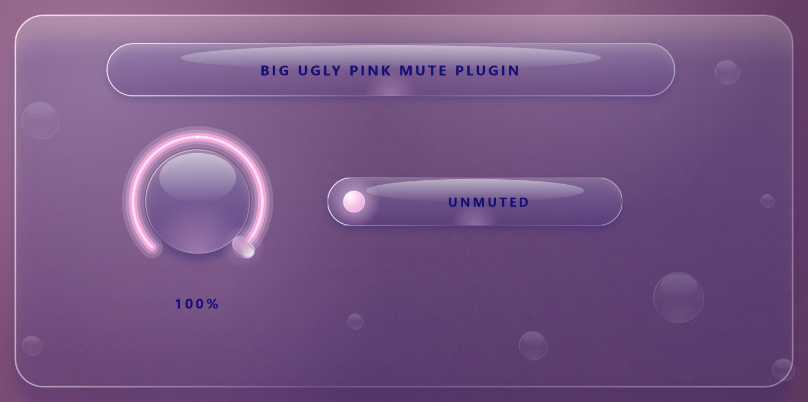
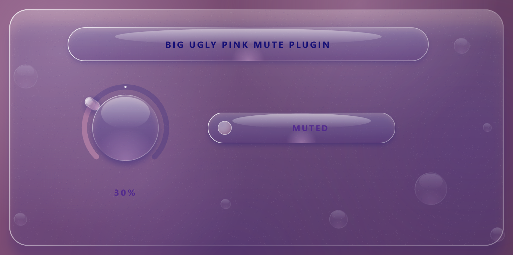

# Big Ugly Pink Mute Plugin

Its Fruity Mute 2 but it works on everything

| Unmuted | Muted |
| --- | --- |
|  |  |

Turn the dial down, the channel mutes. Turn it up, it unmutes. 

You can get some cool effects by muting with this plugin and automating the channel mix.

## Building (Windows)

Requires CMake 3.22+, Ninja, Git and Visual Studio 2022 (or the Build Tools) with the C++ workload.

```bat
build.bat
```

The script clones JUCE 8.0.4 and builds in `%LOCALAPPDATA%\Temp\gm`, because a deeply nested folder can exceed Windows' 260-character path limit during the build. Set `JUCE_DIR` to use an existing JUCE checkout instead.

The plugin is written to:

```
%LOCALAPPDATA%\Temp\gm\build\GlassMute_artefacts\Release\VST3\Big Ugly Pink Mute Plugin.vst3
```

Copy that folder into `C:\Program Files\Common Files\VST3` (needs admin), then rescan plugins in your DAW.

## Tests

Configure with `-DGLASSMUTE_BUILD_TESTS=ON` to build `GlassMuteTests`, which runs audio through the processor (default state, 50% threshold, silence when muted, save/restore) and renders both UI states to PNGs:

```bat
GlassMuteTests.exe <output-folder>
```
